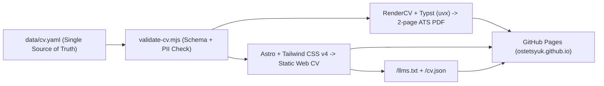

# Oleksiy Stetsyuk — CV-as-Code

[](https://github.com/ostetsyuk/ostetsyuk.github.io/actions/workflows/deploy.yml)

Production-grade **CV-as-Code** repository for **Oleksiy Stetsyuk** (Senior DevOps / Site Reliability Engineer · Infrastructure Team Lead).
A single bilingual YAML file (`data/cv.yaml`) automatically builds and deploys the interactive Web CV, a 2-page ATS-friendly PDF, an AI-readable `/llms.txt`, and a JSON Resume `/cv.json` on every push to `main`.

## Live Endpoints

| Artifact | URL | Audience |
|---|---|---|
| **Interactive Web CV** | https://ostetsyuk.github.io/ | Hiring managers & tech leads (EN/UA, Dark/Light, Skill Filter, `⌘K` CLI) |
| **ATS-Friendly PDF (2 pages)** | https://ostetsyuk.github.io/Oleksiy_Stetsyuk_CV.pdf | ATS parsers (Greenhouse, Workday, Lever) & recruiters |
| **LLM / AI Profile** | https://ostetsyuk.github.io/llms.txt | AI recruiting assistants & autonomous agents |
| **JSON Resume (v1)** | https://ostetsyuk.github.io/cv.json | Structured machine-readable integrations |
| **GitHub Profile** | https://github.com/stetsyuka | Profile README synced from `PROFILE_README.md` |
| **YouTube Channel** | https://www.youtube.com/@inference_lab | Technical courses (`Claude Code`, `Orca`, `VS Code`) |

## Architecture



## Key Features

- **Dual-Format Output:** Human-friendly Web CV + single-column vector ATS PDF compiled from the exact same `data/cv.yaml`.
- **Bilingual (EN / UA):** Instant language toggle persisted in `localStorage` and shareable via `?lang=ua` / `?lang=en`.
- **Interactive Stack Filter:** Click any technology chip (`Azure`, `AKS`, `Terraform`, `OpenTelemetry`, `HashiCorp Vault`, `Agentic SRE`, etc.) to highlight matching architecture case studies, roles, and public courses.
- **Interactive `>_ CLI` Mode (`⌘K` / `Ctrl+K`):** Native `<dialog closedby="any">` terminal supporting `help`, `whoami`, `impact`, `stack`, `cases`, `courses`, `experience`, `contact`, `pdf`, `llms`, `lang en|ua`, `theme`.
- **Modern Web Standards:** Native `color-scheme: light dark` + CSS `light-dark()` with zero-FOUC inline boot script, `@media print` stylesheet, OpenGraph card (`public/og-card.svg`), JSON-LD `Person` schema.
- **Privacy Guardrails:** `scripts/validate-cv.mjs` runs in CI and fails the build if a personal phone number (`+380`) is accidentally introduced into `data/cv.yaml`.

## Repository Layout

```text
ostetsyuk.github.io/
├── data/cv.yaml                      # Single source of truth (EN + UA)
├── scripts/
│   ├── validate-cv.mjs               # Schema & privacy validation
│   └── generate-rendercv.mjs         # Translates data/cv.yaml -> RenderCV/Typst config
├── src/
│   ├── layouts/BaseLayout.astro      # Meta, FOUC-free theme/lang boot, JSON-LD, OG
│   ├── lib/cv.ts                     # Typed YAML loader
│   ├── styles/global.css             # Tailwind v4 + light-dark() tokens + print CSS
│   └── pages/
│       ├── index.astro               # Main Web CV + interactive filter + CLI modal
│       ├── llms.txt.ts               # Build-time /llms.txt generator
│       └── cv.json.ts                # Build-time /cv.json generator
├── public/
│   ├── Oleksiy_Stetsyuk_CV.pdf       # Rendered 2-page ATS PDF (rebuilt in CI)
│   ├── og-card.svg                   # Social share preview card
│   └── favicon.svg
├── .github/workflows/deploy.yml      # CI/CD: validate -> PDF -> Astro -> Pages
├── PROFILE_README.md                 # Source template for github.com/stetsyuka/stetsyuka
└── CLAUDE.md                         # Maintenance rules & runbook for AI assistants
```

## Updating the Resume

1. Edit **`data/cv.yaml`** (keep both `en` and `ua` fields updated; never add personal phone numbers).
2. Verify locally:
   ```bash
   pnpm install
   pnpm check       # Validate data/cv.yaml + Astro/TypeScript check
   pnpm pdf:build   # Rebuild public/Oleksiy_Stetsyuk_CV.pdf (verify it stays 2 pages)
   pnpm dev         # Local preview at http://localhost:4321
   pnpm build       # Full production static build -> dist/
   ```
3. Commit and push to `main`:
   ```bash
   git add -A && git commit -m "content: update experience / skills" && git push
   ```
   GitHub Actions builds and deploys to https://ostetsyuk.github.io/ in ~35 seconds.

### Syncing GitHub Profile README (`stetsyuka/stetsyuka`)
Whenever top-level focus, metrics, or featured courses change, update `PROFILE_README.md` and push it to `stetsyuka/stetsyuka`:
```bash
SHA=$(gh api repos/stetsyuka/stetsyuka/contents/README.md --jq '.sha')
gh api -X PUT repos/stetsyuka/stetsyuka/contents/README.md \
  -f message="docs: sync profile README with CV" \
  -f content="$(base64 < PROFILE_README.md | tr -d '\n')" \
  -f sha="$SHA"
```

### Optional: Custom Domain (e.g. `stetsyuk.dev`)
1. Point apex DNS (`A` records to GitHub Pages IPs) or `CNAME` to `ostetsyuk.github.io`.
2. Add `public/CNAME` containing the domain name and update `site` in `astro.config.mjs` + `meta.site_url` in `data/cv.yaml`.
3. Enable **Enforce HTTPS** in *Repository Settings → Pages*.
